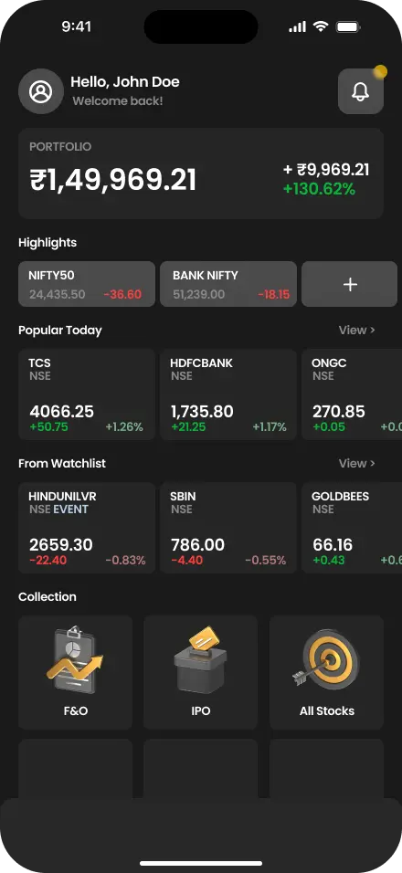
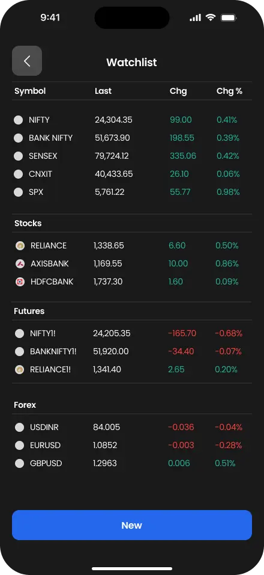
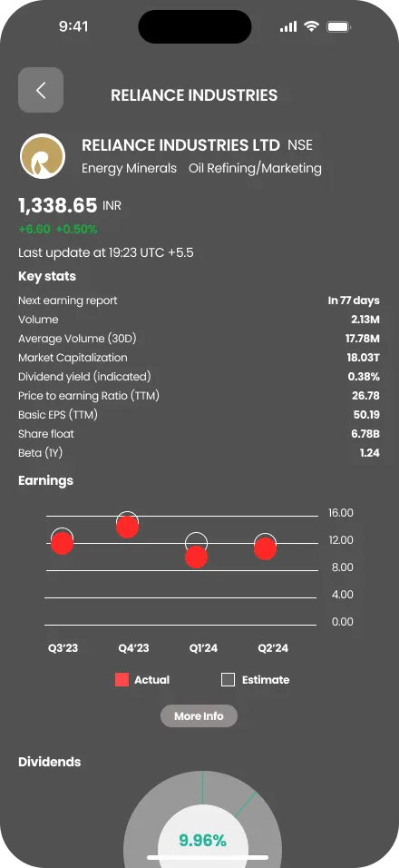
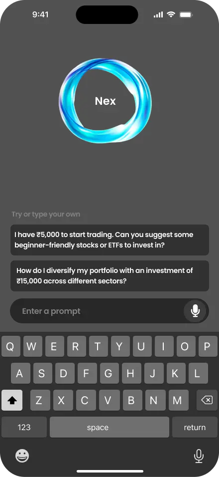
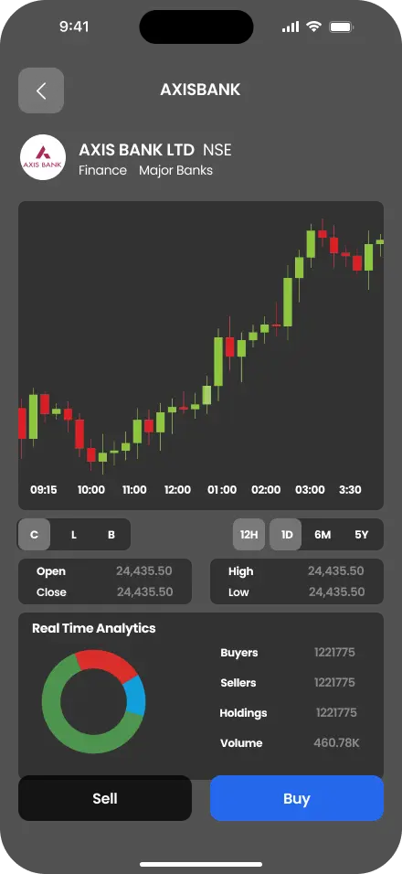
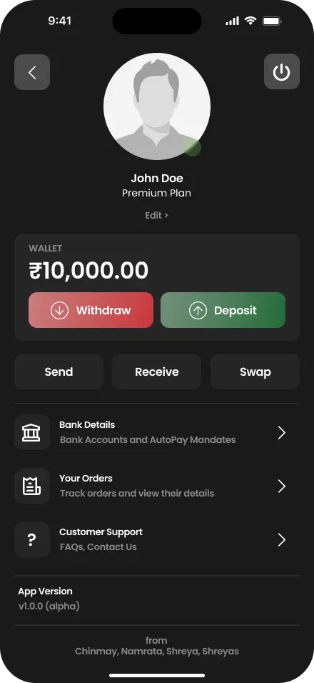

# NexTrade

Landing page for **NexTrade**, an AI-based algorithmic trading platform for stocks, mutual funds, F&Os and IPOs.

## Mockups

All app mockups in [`mockups/`](mockups) were designed by me in **Figma**.

| | | |
|---|---|---|
|  |  |  |
| Home | Watchlist | Insights |
|  |  |  |
| AI assistant | Buy stocks | Profile |

The rest (sign in/up, notifications, bank details, sell, T&C, privacy policy) are in the same folder.

## Tech

Static HTML, Tailwind CSS (Play CDN), daisyUI, Font Awesome and a little vanilla JS. No build step.

## Run locally

```sh
python3 -m http.server 8000
```

Then open http://localhost:8000.

## License

[MIT](LICENSE)
